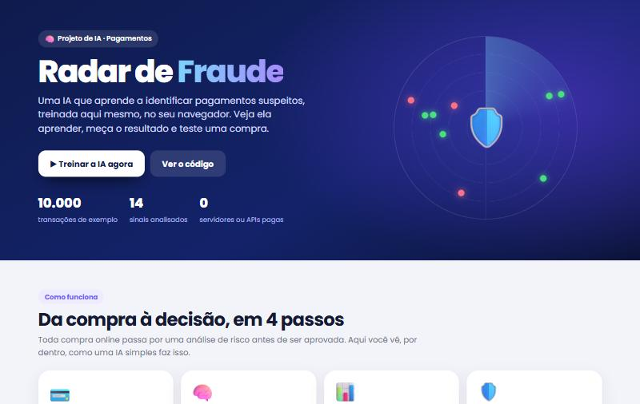
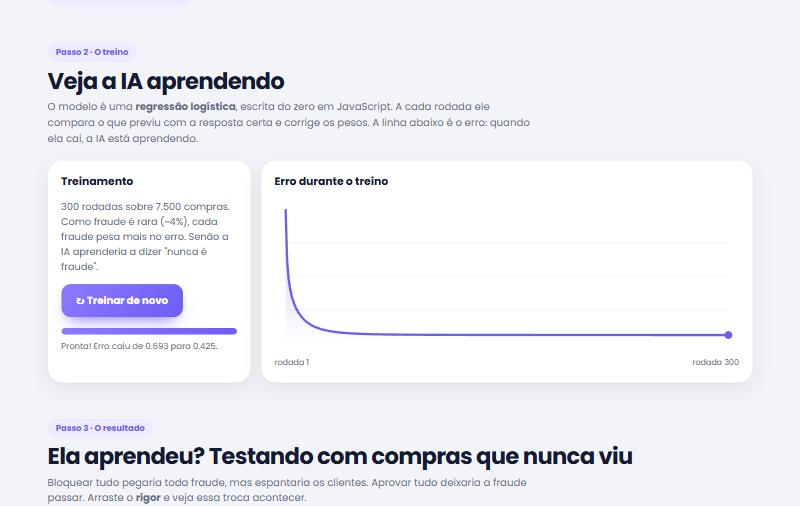
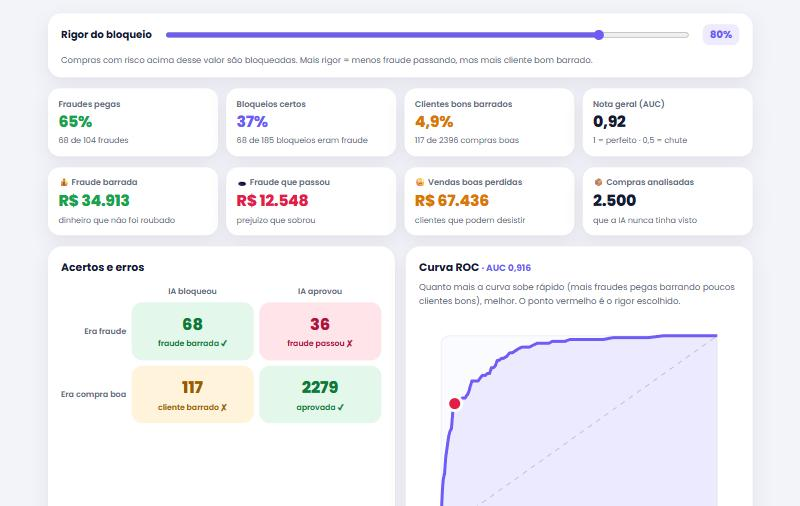
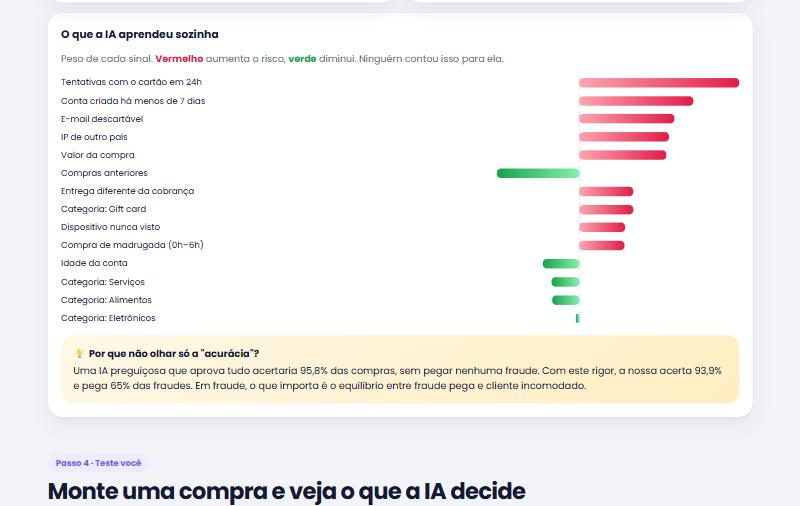
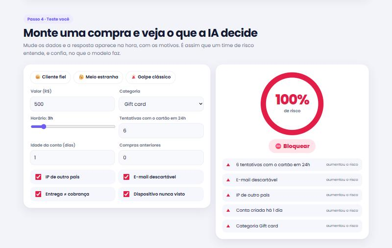

<div align="center">

# 🛡️ Radar de Fraude

**Uma IA que aprende a identificar pagamentos suspeitos, treinada direto no navegador.**

[](https://rico2978bg-hub.github.io/radar-fraude/)

[](https://github.com/rico2978bg-hub/radar-fraude/actions/workflows/testes.yml)




</div>

## O problema

Toda compra online passa por uma análise de risco antes de ser aprovada. O desafio é equilibrar duas coisas:

- **deixar fraude passar** custa dinheiro (estorno, produto perdido);
- **barrar cliente bom** também custa (venda perdida, cliente que não volta).

O Radar de Fraude mostra, por dentro e de forma interativa, como um modelo de IA aprende a fazer essa escolha e como medir se ele está fazendo um bom trabalho.

## O que dá para fazer

| | |
|---|---|
| **1. Ver os dados** | 10 mil compras simuladas, cada uma com 14 sinais e a resposta (fraude ou não). |
| **2. Ver a IA aprendendo** | O treino roda no navegador e o gráfico mostra o erro caindo, rodada a rodada. |
| **3. Medir o resultado** | Fraudes pegas, bloqueios certos, clientes barrados, AUC, matriz de acertos e erros, curva ROC e **quanto dinheiro foi salvo ou perdido**. |
| **4. Ajustar o rigor** | Um controle mostra, ao vivo, a troca entre pegar mais fraude e incomodar mais cliente bom. |
| **5. Testar uma compra** | Você monta a compra, e a IA decide entre **aprovar, revisar ou bloquear**, explicando os motivos. |

<div align="center">




</div>

## Como a IA funciona

1. **Dados sintéticos realistas.** As compras são geradas com padrões conhecidos de fraude: conta recém-criada, várias tentativas com o cartão, IP de outro país, e-mail descartável, compra de madrugada, gift card… A regra que define a fraude fica **escondida** do modelo, que tem uma interação entre sinais e ruído aleatório. A IA precisa descobrir os padrões sozinha.
2. **Treino e teste separados.** O modelo estuda 75% das compras e é avaliado nos outros 25%, que ele nunca viu.
3. **Regressão logística escrita do zero**, com descida do gradiente, padronização dos sinais e regularização L2. Não usa nenhuma biblioteca de IA: é o algoritmo em ~80 linhas de JavaScript.
4. **Classe rara tratada com peso.** Fraude é ~4% das compras. Sem cuidado, o modelo aprende a dizer "nunca é fraude" e acerta 96% sem servir para nada. Por isso cada fraude pesa mais no erro.
5. **Explicável.** Para cada compra, o modelo mostra quanto cada sinal empurrou o risco para cima ou para baixo. As explicações somam exatamente o risco previsto, e há um teste automático que garante isso.

## Resultado (nas compras que o modelo nunca viu)

Com o rigor padrão de 80%:

| Métrica | Valor | O que significa |
|---|---|---|
| Fraudes pegas (recall) | **65%** | de cada 100 fraudes, 65 são barradas |
| Bloqueios certos (precisão) | **37%** | dos bloqueios, 37% eram fraude mesmo |
| Clientes bons barrados | **4,9%** | de cada 100 clientes bons, ~5 são incomodados |
| AUC | **0,92** | 1 = perfeito, 0,5 = chute |

> 💡 Por que não usar só a "acurácia"? Um modelo que aprova tudo acertaria **95,8%** das compras e não pegaria **nenhuma** fraude. Em fraude, o que importa é o equilíbrio entre fraude pega e cliente incomodado.

## Por que regressão logística?

- **Explicável:** dá para dizer o motivo de cada decisão, o que é essencial em risco e pagamentos.
- **Rápida:** treina 7.500 compras em ~0,3 s, no navegador do celular.
- **Base sólida:** é a referência com que modelos mais complexos são comparados.

## Próximos passos

- Comparar com árvores de decisão e gradient boosting.
- Calibrar as probabilidades, para que "80% de risco" signifique 80% de chance real.
- Usar uma fila de revisão manual com custo por análise, para escolher o rigor pelo lucro.
- Detectar *drift*, ou seja, quando o padrão da fraude muda e o modelo precisa ser treinado de novo.

## Rodar no seu computador

```bash
git clone https://github.com/rico2978bg-hub/radar-fraude.git
cd radar-fraude
python -m http.server 8000     # ou: npx serve
# abra http://localhost:8000
```

O projeto usa módulos de JavaScript, então precisa de um servidor local. Abrir o `index.html` direto com dois cliques não funciona.

### Testes

```bash
npm test    # usa o executor de testes do próprio Node (node --test), sem instalar nada
```

São 11 testes. Eles conferem, entre outras coisas, que:
- o modelo tem AUC acima de 0,85 em dados novos;
- ele aprende os sinais certos;
- as métricas batem com um exemplo feito à mão;
- as explicações somam exatamente o risco previsto.

Eles rodam automaticamente no GitHub Actions a cada envio de código.

## Estrutura

```
index.html            interface: dados, treino ao vivo, resultados e simulador
modelo.js             o "cérebro": dados, treino, métricas e explicações (sem dependências)
testes/modelo.test.js testes automáticos do modelo
```

---

<sub>Projeto de estudo com dados 100% sintéticos, gerados no navegador. Nenhum dado real é usado ou enviado. Ícones: [Fluent Emoji 3D](https://github.com/microsoft/fluentui-emoji), da Microsoft (licença MIT).</sub>
